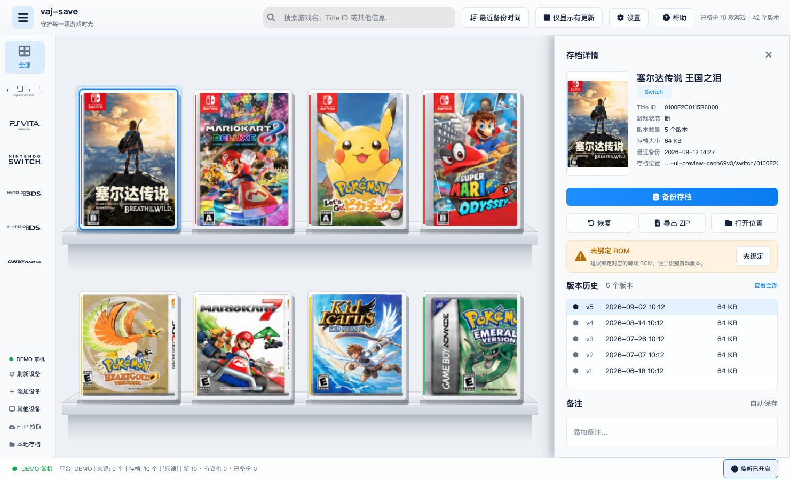

# vaj-save

掌机存档备份与版本管理。插上 SD 卡或 U 盘，按机种浏览游戏、备份存档、保留多个历史版本，再导出或恢复。

- 卡带柜按机种分类：掌机 PSP / Vita / Switch / 3DS / NDS / GB / GBC / GBA，主机 PS3 / PS4 / Wii U / Wii / Xbox 360
- 备份到 `~/Documents/vaj-save/`（可在「设置」里改），相同内容去重，有变化才开新版本
- 一条存档保留多个历史版本，可删除单个版本、导出 / 导入 ZIP
- 「备份有更新」只备份有变化的存档，过程可取消；插入后自动备份默认关闭
- 支持 FTP 只读增量拉取，以及 Windows 上的 DBI MTP 直连 Switch
- 3DS 加密 SD 卡可以直接读取存档，不必先用 Checkpoint 导出（见下文）
- 用卡上的文件系统卷序列号记住存档根目录，下次插入只扫这些目录（刷新设备会全量扫描）

**本工具只读**：扫描和备份都不会写入掌机，恢复只把存档拷到你选的文件夹。

## 界面预览



> 截图使用演示存档和封面，不包含用户真实数据。

## 快速开始

**macOS**（构建出可双击的 `.app`，开发机需要 Python 3.11+）：

```bash
PYTHON=python3 ./scripts/build-macos-app.sh
open dist/vaj-save.app
```

产物是 `dist/vaj-save.app`，可拖进「应用程序」以后双击启动。给别人用时对方不必装 Python。

**Windows**（必须在 Windows 上构建）：

```powershell
# PowerShell，已装 Python 3.11+
$env:PYTHON = "python"
.\scripts\build-windows-app.ps1
```

或用 `scripts\build-windows-app.bat`，产物是 `dist\vaj-save\vaj-save.exe`，请整个文件夹拷走，不要只拷 exe。

**命令行**：

```bash
pip install -e ".[dev]"

vajsave scan /Volumes/YOUR_VOLUME
vajsave scan /Volumes/YOUR_VOLUME --json
vajsave scan
vajsave watch
```

## 支持的挂载方式

| 方式 | 识别条件 | 说明 |
|------|----------|------|
| PSP USB | `PSP/SAVEDATA/` | 机上打开「USB 连接」后插线，或 Memory Stick 读卡器 |
| Vita USB | `user/00/savedata/` 或 `ux0/user/00/savedata/` | VitaShell USB 模式 |
| Vita 导出 | `data/savegames/` | Vita Save Manager 解密导出 |
| Vita + Adrenaline | 同时有 Vita 目录和 `pspemu/PSP/SAVEDATA/` | 一条卷上会列出两个来源 |
| Switch Checkpoint | `switch/Checkpoint/saves/` | Hekate UMS 或拔卡读卡器 |
| Switch JKSV | `JKSV/<Game>/...` | 按游戏 / 用户 / 槽位宽松列举；跳过 Saves/ExtData 等保留名 |
| Switch SD | 仅有 `atmosphere/` 或 `switch/` | 识别为 Switch 卡，存档列表可为空 |
| Switch DBI MTP | 设备上有 `Saves` 存储 | 见「DBI MTP 直连」 |
| 3DS Checkpoint | `3ds/Checkpoint/saves/` | 拔卡读卡器 |
| 3DS JKSM | `JKSV/Saves/`（或 ExtData/SysSave） | 与 Switch JKSV 同根目录名，按子目录区分 |
| 3DS 加密 SD | 卡上有 `Nintendo 3DS/` | 配置密钥后可直接读取，否则只标记为加密卡 |
| GBA EZ-Flash | `SAVER/*.sav` | 只认固定目录，不全盘搜 `.sav` |
| GBA EverDrive | `GBASYS/SAVE/*.{sav,srm,fla,eep}` | Mini / X5 |
| GBA EverDrive Pro | `EDGBA/gamedata/<rom>/bram.*` | 显示名为游戏文件夹名 |
| GBA SuperChis / SuperFW | `SAVEGAME/*.sav`；有 `.superfw/` 时也认 `SAVES/*.sav` | `SAVES/` 太泛，无指纹不收 |
| NDS TWiLight | 目录内有 `.nds` 且 `saves/*.sav` | 常见于 `roms/nds/` |
| NDS R4/Wood | 同目录 `.nds` + 同名 `.sav` | 需卡根指纹（`_nds/` / `R4.dat` / `TTMenu/` / `_system_/`）或 `roms/nds` |
| GB | `roms/gb/`、EverDrive `EDGB/` / `GBOS/`、同名 `.gb` + `.sav`/`.srm` | Dock 独立机种 |
| GBC | `roms/gbc/`、同名 `.gbc` + `.sav`/`.srm` | Dock 独立机种 |
| EZ-Flash SAVER 分流 | `SAVER/foo.sav` 旁有 `foo.gb` / `foo.gbc` / `foo.gba` | 按 ROM 后缀记为 GB / GBC / GBA；没有 ROM 仍为 GBA |
| PS3 | `PS3/SAVEDATA/`，或 webMAN 的 `dev_hdd0/home/<用户>/savedata/` | FTP 预设「PS3 实机」，只拉 `savedata` |
| PS4 | GoldHEN `user/home/<账号>/savedata/CUSA…`，或 `PS4/SAVEDATA/` | FTP 预设「PS4 实机」（端口 2121），只拉 `savedata`。系统设置导出的 USB 存档是加密包，能备份，但没有明文标题 |
| Wii U | `storage_mlc/usr/save/00050000/<Title>`，或 `wiiu/backups/` | FTPiiU 只拉存档，另拉 `usr/title/.../meta` 用来读游戏名，不拉 `code` |
| Wii | `savegames/<游戏ID>/`，或 NAND `title/00010000/<ID>/data` | ftpii 只拉 `data`，不拉 `content`（游戏本体）。WiiWare 在 `title/00010001` |
| Xbox 360 | `Content/<档案>/<TitleID>/00000001/`，Aurora 上多为 `Hdd1/Content` | 只拉 `00000001`（存档）。`00000002` 是安装内容，不下载 |

没有上述指纹的普通 U 盘会标为 `unknown`，不会误报成某台掌机。主机和掌机一样只读：扫描和 FTP 都不会写回机器。恢复仍只拷到你选的文件夹。

## Windows 设备检测

用 Win32 `GetLogicalDrives` / `GetDriveTypeW` / `GetVolumeInformationW` 枚举盘符，列出可移动盘与固定盘，跳过光驱、网络映射盘和无根目录的盘。卷标会显示出来，例如 `F: KINGSTON`；空卷标显示为 `E: 可移动磁盘`。可移动盘排在固定盘前面。

U 盘，以及以 USB 大容量存储方式直连的掌机（Hekate UMS、读卡器、PSP/Vita 的 USB 连接模式）都会得到盘符，因此都能被检测到。

**默认选中**：启动和点「刷新」时优先选可移动盘，同组里选盘符靠后的那个。所以内置盘 C/D/E 加 U 盘 F: 的场景会默认选中 F:；没有可移动盘时回退到字母最大的盘（不会选 C:）。你自己点选的设备不会被自动替换。

## Windows DBI MTP 直连 Switch

Switch 的存档在主机内部，不在 SD 卡上。用 DBI 的 `Run MTP responder` 可以免读卡器直连，也免去 Checkpoint 导出：

- 应用自动发现带 `Saves` 存储的设备（DBI、Haze 等 MTP responder 都行），普通手机、相机不会出现；设备像盘符一样进入列表并支持热插拔。
- 选中后先把 `Saves`（`Installed games` / `Uninstalled games` 下每个 `游戏/用户` 目录）以及 SD 上的 `switch/Checkpoint/saves`、`JKSV/`、`switch/DBI/saves/` 子树增量拉到本地缓存，再走正常扫描与备份。
- 不会拉取 NSP 安装盘、相册或整张 SD。恢复仍然只写你选的本地文件夹，绝不写回掌机。
- macOS / Linux 不提供 MTP 协议栈，发现列表为空；请改用 Hekate UMS，或拔卡。

## 3DS 加密 SD 直读

3DS 把存档以主机唯一的密钥加密后放在 SD 卡的 `Nintendo 3DS/` 里，所以直接插卡时正常情况下看不到任何存档——这也是为什么大家习惯先用 Checkpoint 导出。

填入本机的两个密钥文件后，本工具可以直接读取这张卡上的存档，不需要 Checkpoint：

1. 「设置」里选择主机导出的 `movable.sed`（GodMode9：`SysNAND Virtual/movable.sed`，或解密后的 `essential.exefs`）
2. 同一处选择 `boot9_prot.bin`（GodMode9：`SysNAND Virtual/boot9_prot.bin`）
3. 重新扫描设备，卡上的存档会以正常条目出现在画廊里，可备份、可保留多个版本

说明：

- 两个文件都只用于在本机派生出解密密钥，**只保存路径**，不复制进备份库、不写入日志。
- 备份下来的是**解密后的存档**（`00000001.sav` 容器本身，或 extdata 里的文件），可直接交给存档编辑器之类的工具使用；卡上的原文件永远不动。
- 如果密钥文件不属于这张卡，扫描会给出「卡上没有与 movable.sed 匹配的 ID0 目录」的提示，此时该卡仍按加密容器处理，不会出错。
- 卡上读不到游戏名（游戏名在主机内部，封面在需要额外密钥的加密内容里），所以条目先显示 8 位 Title ID；投放对应封面 `covers/3ds/<Title ID>.png` 或录入备注即可。
- 自检：`python tools/check-threeds-sd.py /Volumes/YOUR_SD --movable-sed ~/keys/movable.sed --boot9 ~/keys/boot9_prot.bin`，只读检查密钥是否匹配这张卡、存档是否为有效的 3DS 存档容器。
- 卡带游戏的存档在卡带内部，不在 SD 上，任何工具都扫不到。

## 备份路径设置

工具栏「设置」里可以改本地备份库路径，选择后立即生效并记住：

| 平台 | 配置文件位置 |
|------|--------------|
| Windows | `%APPDATA%\vaj-save\config.json` |
| macOS | `~/Library/Application Support/vaj-save/config.json` |
| Linux | `$XDG_CONFIG_HOME/vaj-save/config.json`（或 `~/.config/vaj-save/config.json`） |

配置读写失败会安全回退到默认路径（`~/Documents/vaj-save/`），不影响启动。

## 百度网盘同步

从左上角菜单选择「配置百度网盘」，填写自己在百度网盘开放平台创建的应用 App Key、Secret Key 和应用名称，再按提示完成设备码授权。应用需要启用百度网盘文件访问权限。应用密钥和授权令牌只保存在操作系统凭据库中；如果系统没有可用的安全凭据库，程序会拒绝保存。

选择「同步到百度网盘」会把本地备份库中的版本 ZIP、游戏目录、备注、收藏状态和版本信息上传到 `/apps/<应用名称>/`。上传的目录清单会移除本机原始存档路径。同步是单向追加：相同版本会跳过，网盘中已有文件不会覆盖或删除；本功能不从网盘下载或恢复。取消时已上传的文件会保留，下一次同步会继续检查并补齐。

## 封面

中间「游戏」列的每一行会优先显示真实封面缩略图，按以下优先级取图：

1. **你自己放的封面**：放到本地备份库的 `<备份库>/covers/<机种>/<名称>.<扩展名>`
   - `<机种>` 取 `psp` / `vita` / `switch` / `3ds` / `nds` / `gba`
   - `<名称>` 取该存档的 Title ID（没有时用游戏名）
   - 支持的扩展名：`png` `jpg` `jpeg` `webp` `bmp` `gif`
   - 画廊只接受竖版或近方形图像；横向文件不会被删除，但不会作为封面显示
2. **自动下载**：GBA/NDS 通过 ROM 摘要匹配内置离线元数据索引，PSP/Vita/3DS/PS4/Xbox 360 按存档标题或 Title ID，从 libretro 官方封面库下载。PS3、Wii、Wii U 优先用产品编号向 GameTDB 要竖版盒装图（例如 `BLUS30443`、`RMCE01`、`ALZE01`），对不上再按游戏名走 libretro。缓存到 `<备份库>/covers/<机种>/`。缓存有效时完全不走网络；下载失败会静默跳过，不会顶替已有封面。
3. **存档内的图标**：扫描设备时会只读查找存档目录里的图标（如 PSP 的 `ICON0.PNG`、Vita 的 `sce_sys/icon0.png`），以及裸存档文件同名的 `<游戏名>.png` / `.jpg`
4. 都没有时显示浅灰色方块占位

示例（备份库为默认的 `~/Documents/vaj-save/`）：

```
# PSP 存档 ULJM05800 的封面
~/Documents/vaj-save/covers/psp/ULJM05800.png

# Vita 游戏 Persona 4 Golden（无 Title ID 时用游戏名）
~/Documents/vaj-save/covers/vita/Persona 4 Golden.jpg
```

## 游戏信息（GB / GBC / GBA / NDS）

这些机种的存档通过 ROM 摘要（SHA1/CRC32）匹配身份，详情栏会优先显示规范游戏名与地区，封面按规范名下载。程序随包内置由 No-Intro DAT 生成的离线索引，装完即可用，不需要联网。

如果你的 ROM 是汉化版、改版，摘要不在官方索引里：GBA 会用 ROM 头部的卡带编号在内置索引里做一次保守匹配，只在编号唯一对应某个正式版时才采用；否则显示为无元数据，绝不会按文件名猜。

也可以自己提供索引：把 libretro / No-Intro 的 `.dat` / `.xml` / 紧凑 `.json` 放到「设置」里的 `Libretro 元数据目录`，或 `<备份库>/metadata/libretro/`。索引只在需要时解析一次，查不到不会影响扫描、备份和封面回退。

## 只读边界

本工具定位为**只读管理**，不做以下事情：

- 不写入掌机，恢复只拷贝到你选择的文件夹（要写回掌机，请把恢复目标选成 Checkpoint / JKSV / SAVEDATA 目录，由掌机上的工具完成导入）
- 不改存档内容，不做存档编辑器
- 3DS 直读也只读：密钥只用于解密，卡上的加密原文件永远不会被修改
